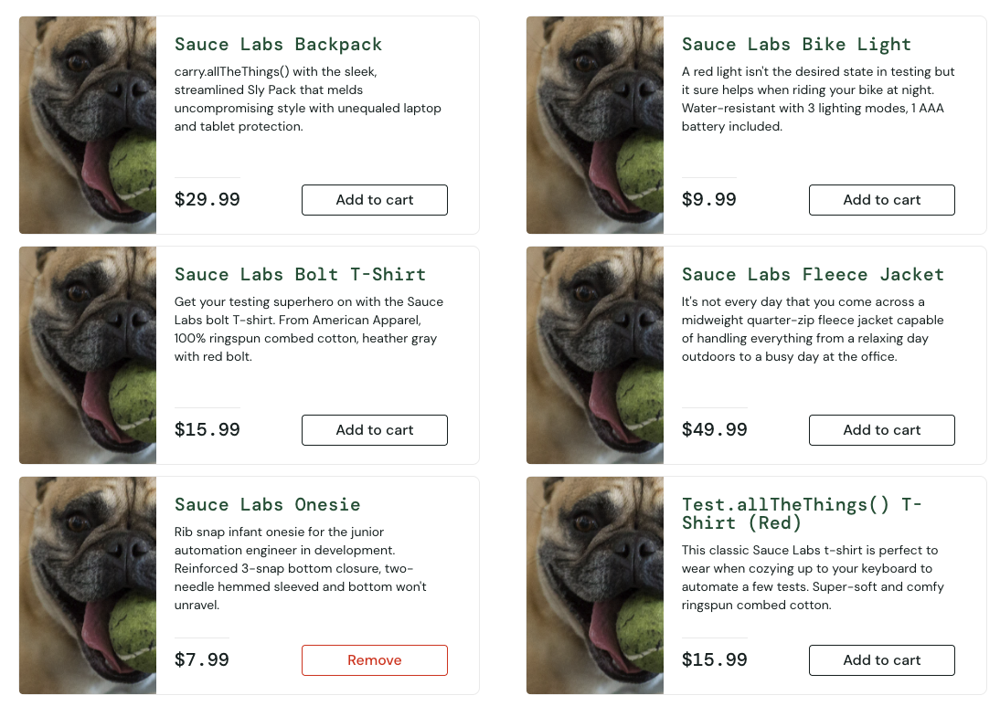
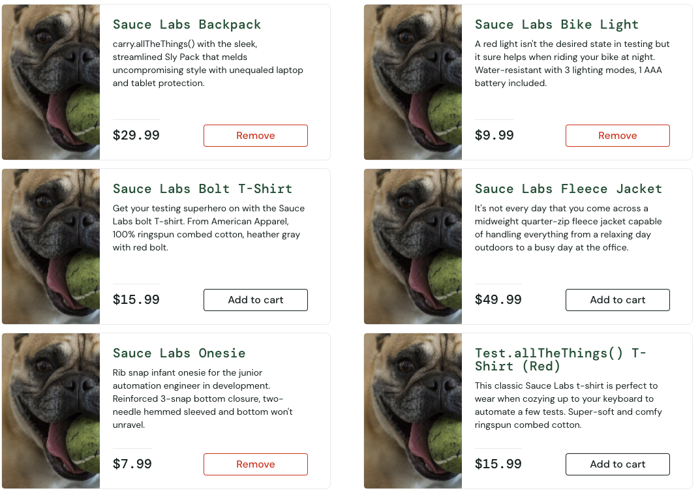
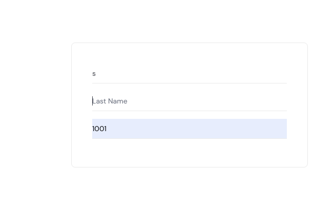

# Bugs encontrados: problem_user

- **Aplicación:** https://www.saucedemo.com (en inglés)
- **Fecha:** 23/11/2026
- **Usuario de prueba:** problem_user
- **Tester:** Jhonny Gómez Campero
- **Navegador:** Chrome, traducción automática desactivada
- **Nota:** problem_user es un usuario de prueba de la web con defectos conocidos para practicar. Con standard_user estos flujos funcionan correctamente.

## Resumen

| ID | Módulo | Título | Severidad | Estado |
|----|--------|--------|-----------|--------|
| BUG-001 | Catálogo | Todas las imágenes de producto son incorrectas | Media | Abierto |
| BUG-002 | Carrito | Add to cart inconsistente y Remove no funciona | Alta | Abierto |
| BUG-003 | Checkout | El campo Last Name no admite texto | Alta | Abierto |

## BUG-001: Todas las imágenes de producto son incorrectas

| Campo | Detalle |
|-------|---------|
| Módulo | Catálogo de productos |
| Severidad | Media |
| Prioridad | Media |
| Estado | Abierto |

**Pasos para reproducir**
1. Entrar en saucedemo.com con problem_user.
2. Observar la lista de productos del catálogo.

**Resultado esperado:** cada producto muestra su propia imagen.

**Resultado obtenido:** ninguna imagen concuerda con su producto. Todos los productos muestran la misma foto de un perro.

**Impacto:** el cliente no puede identificar visualmente los productos. No impide la compra.

**Evidencia:** 

## BUG-002: Add to cart inconsistente y Remove no funciona

| Campo | Detalle |
|-------|---------|
| Módulo | Carrito |
| Severidad | Alta |
| Prioridad | Alta |
| Estado | Abierto |

**Pasos para reproducir**
1. Entrar con problem_user.
2. Pulsar Add to cart en cada uno de los productos.
3. Revisar qué productos quedaron añadidos al carrito.
4. Intentar quitar un producto del carrito con Remove.

**Resultado esperado:** todos los productos se añaden al carrito y se pueden quitar con Remove.

**Resultado obtenido:** al pulsar Add to cart, en algunos productos se añade y en otros no. Después, quitar un producto del carrito es imposible.

**Impacto:** el usuario no puede controlar el contenido de su carrito.

**Evidencia:** 

## BUG-003: El campo Last Name no admite texto

| Campo | Detalle |
|-------|---------|
| Módulo | Checkout, formulario de datos |
| Severidad | Alta |
| Prioridad | Alta |
| Estado | Abierto |
| Caso relacionado | TC-CHK-07 |

**Pasos para reproducir**
1. Entrar con problem_user y añadir un producto al carrito.
2. Ir al carrito y pulsar Checkout.
3. Escribir un nombre en First Name.
4. Hacer clic en Last Name y escribir un apellido.
5. Rellenar el código postal y pulsar Continue.

**Resultado esperado:** el apellido se escribe en Last Name y se accede al resumen del pedido.

**Resultado obtenido:** el texto del apellido no se escribe en Last Name, sino que vuelve a escribirse en First Name. Al pulsar Continue aparece el mensaje "Error: Last Name is required" y no se puede avanzar.

**Impacto:** no se puede completar el formulario ni llegar a la confirmación del pedido. Bloquea la compra.

**Evidencia:** 
